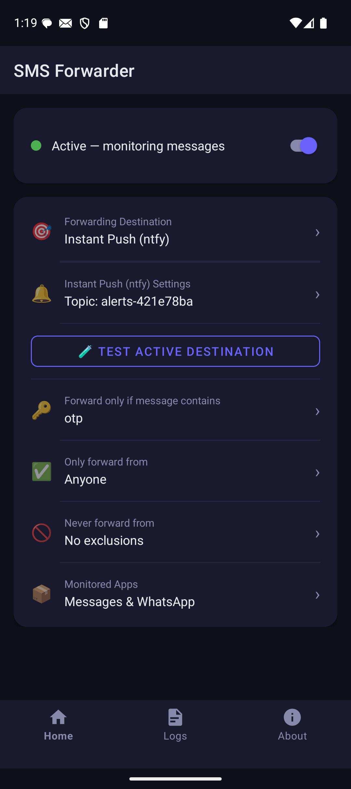
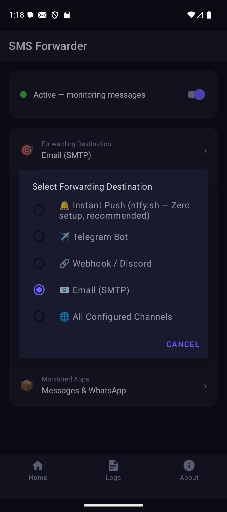
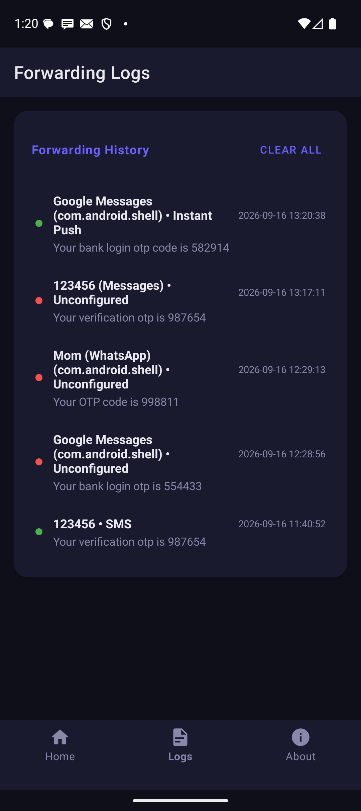

# 📲 SMS & Message Forwarder — Smart Automation for Android

> **App Root Folder:** `/mnt/1fc0b605-b95c-4190-ba0a-ae87f22cc120/development/sms-forwarder`


<p align="center">
  <b>A versatile, privacy-first Android utility to automatically forward incoming SMS, RCS, and WhatsApp notifications (2FA OTPs, banking alerts, order updates, server alerts) to Instant Push (ntfy.sh), Telegram, Email (SMTP), or Webhooks (Discord/Slack).</b>
</p>

<p align="center">
  
  
  
  
  
  
</p>

---

## 📸 Screenshots

| Home Dashboard | Destination Setup | Forwarding History (Logs) |
| :---: | :---: | :---: |
|  |  |  |

---

## 📑 Table of Contents
- [Why Notification Access Architecture?](#-why-notification-access-architecture)
- [Key Use Cases](#-key-use-cases)
- [How It Works (Architecture)](#-how-it-works-architecture)
- [Features](#-features)
- [Forwarding Channels Setup](#-forwarding-channels-setup)
  - [1. SMS / Messaging App Forwarding](#1-sms--messaging-app-forwarding)
  - [2. Instant Push (ntfy.sh) — Easiest, Zero Setup (Recommended)](#2-instant-push-ntfysh--easiest-zero-setup-recommended)
  - [3. Telegram Bot](#3-telegram-bot)
  - [4. Email (SMTP)](#4-email-smtp)
  - [5. Webhook / Discord / Slack](#5-webhook--discord--slack)
- [Filter Rules & Settings](#-filter-rules--settings)
- [OEM Background Setup (OnePlus, Samsung, Xiaomi, Pixel)](#-oem-background-setup)
- [Google Play Store Publishing Guide](#-google-play-store-publishing-guide)
- [Developer Testing via ADB](#-developer-testing-via-adb)
- [Building from Source](#-building-from-source)
- [Privacy Policy](#-privacy-policy)

---

## 🌟 Why Notification Access Architecture?

Traditional SMS forwarders rely on legacy Android telephony permissions (`RECEIVE_SMS`, `READ_SMS`, `SEND_SMS`). On modern Android and the Google Play Store, these permissions present severe drawbacks:
1. **Google Play Policy Restrictions**: Google Play restricts SMS permissions strictly to default SMS handling apps, requiring arduous exemption declaration forms that are almost always rejected for utility apps.
2. **RCS Chat Blindspot**: Most modern Android phones (OnePlus, Samsung, Google Pixel) use **RCS (Rich Communication Services)** by default within Google Messages. Legacy SMS receivers **cannot read RCS chat messages**.
3. **No WhatsApp Support**: Carrier SMS listeners cannot intercept WhatsApp or WhatsApp Business alerts.

### The Solution: `NotificationListenerService`
By utilizing Android's official **Notification Access API**:
- 🛡️ **Zero Sensitive SMS Permissions**: Eliminates `RECEIVE_SMS`, `READ_SMS`, and `SEND_SMS` entirely from `AndroidManifest.xml`.
- 🚀 **100% Google Play Approved**: Standard app submission — no high-risk declaration forms, no video submissions, and zero policy grey areas.
- 💬 **Universal Messaging Coverage**: Effortlessly intercepts **SMS**, **RCS**, and **WhatsApp** notifications.
- 🔒 **Zero Cloud Footprint**: Runs 100% on-device. No telemetry, tracking, or developer servers.

---

## 🎯 Key Use Cases

Whether you are an individual wanting multi-device sync, a traveler managing multiple SIMs, or an organization automating alerts, **SMS & Message Forwarder** provides a seamless solution:

- 💻 **Multi-Device & Remote Work**: Receive 2FA login OTPs, banking alerts, and client texts directly in your personal Telegram chat or email inbox while working on your PC, Mac, or tablet without needing your phone.
- ✈️ **International Travel & Dual-SIM**: Leave a secondary phone or local home SIM active with WiFi, and automatically receive all bank verification codes and carrier SMS abroad via Telegram or Email.
- 🔔 **DevOps, IT & Infrastructure Alerts**: Forward SMS downtime alerts, server notifications, or payment gateway pings directly into a team **Discord** channel or **Slack** webhook.
- 👨‍👩‍👧 **Family & Household Sharing**: Automatically forward verification codes for shared family accounts (streaming services, utilities, delivery updates) to a family group chat.
- 📥 **Archival & Record-Keeping**: Forward important transaction confirmations, booking receipts, or delivery tracking numbers directly to an email folder for automated filing.

---

## 🔄 How It Works (Architecture)

```
Incoming Notification
(Google Messages SMS/RCS, WhatsApp, Bank App)
                     │
                     ▼
       NotificationForwarderService
  (android.service.notification.NotificationListenerService)
                     │
     ┌───────────────┴───────────────┐
     ▼                               ▼
Monitored App Filter?          Deduplication Engine
(Default: Messages & WhatsApp) (15s Window Cache)
     │                               │
     └───────────────┬───────────────┘
                     ▼
           Rule & Filter Engine
    ├── 1. Keyword Whitelist (e.g. "otp, alert")
    ├── 2. Negative Blacklist (exclude spam)
    └── 3. Sender Whitelist (specific banks/contacts)
                     │
                     ▼ (Matches)
              Async Dispatcher
      ┌───────────────┬───────────────┬───────────────┐
      ▼               ▼               ▼               ▼
Instant Push    Telegram Bot    Email (SMTP)     Webhook
(ntfy.sh Push) (Telegram API)   (SSL/TLS Java) (Discord/Slack/API)
      │               │               │               │
      └───────────────┴───────────────┴───────────────┘
                      ▼
           Local Forwarding Log
      (Encrypted Internal Storage)
```

---

## 🚀 Features

- 💬 **SMS & Messaging App Forwarding**: Automatically forward messages to another mobile number using direct background SMS (`SmsManager`) or prepare drafts via your device's default messaging app (Google Messages, Samsung Messages).
- 🔔 **Instant Push (`ntfy.sh`) Forwarding**: **Zero setup, zero accounts, zero passwords**. Forward notifications to any device with a private topic link. Receivers can view alerts in their web browser or the free `ntfy` app!
- ✈️ **Telegram Bot Forwarding**: Free, instantaneous forwarding directly to your personal chat or group chat.
- ✉️ **Email (SMTP) Forwarding**: Direct email dispatch supporting SSL/TLS (port 465) and STARTTLS (port 587) with Gmail App Passwords, Outlook, or custom SMTP servers.
- 🔗 **Webhook / Discord / Slack**: Dispatches structured JSON payloads (`content`, `sender`, `body`, `timestamp`) directly to webhooks.
- 💬 **Multi-App Coverage**: Filter notifications from Google Messages, WhatsApp, WhatsApp Business, Samsung Messages, OnePlus Messages, or all installed apps.
- 🔑 **Keyword Whitelist**: Forward only messages containing specific words (case-insensitive, comma-separated: e.g. `otp, secret, bill, balance`).
- 📋 **Sender Whitelist & Blacklist**: Restrict forwarding to known senders or filter out promotional codes.
- ⚡ **Smart Deduplication**: Built-in 15-second deduplication cache prevents re-forwarding when notifications update dynamically.
- 📊 **In-App Delivery History**: View forwarded messages, timestamps, destination channels, and success/failure indicators.
- 🧪 **One-Tap Testing**: Test active destinations (Instant Push, Telegram, Email, Webhook) with live feedback without waiting for an incoming message.

---

## 🛠️ Forwarding Channels Setup

### 1. SMS / Messaging App Forwarding
> Forward alerts to another phone number via cellular SMS or through your default messaging app.

1. In the app, select **Forwarding Destination -> SMS (Messaging App / Phone Number)**.
2. Tap **SMS (Messaging App) Settings**:
   - Enter your **Target Phone Number** (e.g. `+919876543210`).
   - Select your preferred **Forwarding Method**:
     - **Automatic (Recommended)**: Dispatches directly via background SMS if the `SEND_SMS` permission is granted; otherwise prepares a draft in your default messaging app with a notification prompt.
     - **Direct Background SMS**: Uses Android's telephony `SmsManager` to send the message automatically without user interaction.
     - **Via Default Messaging App**: Generates a high-priority prompt allowing you to review and send through Google Messages, Samsung Messages, etc.
   - Tap **Save**.
3. Tap **Test Active Destination** to verify.

### 2. Instant Push (ntfy.sh) — Easiest, Zero Setup (Recommended)
> Ideal for non-technical users, family members, or anyone wanting real-time alerts without creating API tokens, bots, or passwords!

1. In the app, select **Forwarding Destination -> Instant Push (ntfy.sh)**.
2. Tap **Instant Push Settings**:
   - Tap **🎲 GENERATE RANDOM TOPIC CODE** to get a unique, secure topic (e.g. `alerts-421e78ba`), or type your own secret code.
   - Tap **📤 SHARE LINK WITH RECEIVER** to send the private link directly to your secondary phone, family member, or laptop via WhatsApp, SMS, or email.
   - Tap **SAVE**.
3. **How the Receiver Gets Alerts**:
   - **On Any PC / Mac / Laptop**: Open the link (e.g. `https://ntfy.sh/<your-topic>`) in Chrome, Safari, Firefox, or Edge, and click **Allow Notifications**. Real-time desktop popup banners appear instantly when notifications arrive!
   - **On Any Phone (Android / iPhone)**: Install the free [ntfy app](https://ntfy.sh) from the Google Play Store or Apple App Store, and subscribe to the topic code.
4. Tap **Test Active Destination** to verify instant delivery.

### 2. Telegram Bot
1. Open Telegram, search for **@BotFather**, and send `/newbot`. Follow prompts to name your bot and copy the **HTTP API Token**.
2. Search for **@userinfobot** in Telegram, tap **Start**, and copy your numeric **Id** (Chat ID).
   *(If forwarding to a family group: add your bot to the group, send a test message, and use the group's Chat ID).*
3. In the app:
   - Select **Forwarding Destination -> Telegram Bot**.
   - Tap **Telegram Bot Settings** and paste your **Bot Token** and **Chat ID**.
   - Tap **Test Active Destination** to confirm delivery.

### 3. Email (SMTP)
1. In the app, select **Forwarding Destination -> Email (SMTP)**.
2. Tap **Email (SMTP) Settings** and configure:
   - **SMTP Server Host**: `smtp.gmail.com` (or `smtp.office365.com` / custom host).
   - **Port**: `465` (SSL) or `587` (STARTTLS).
   - **Sender Email (Username)**: Your email address (e.g. `user@gmail.com`).
   - **Password**: 
     - **For Gmail**: Go to your [Google Account Security](https://myaccount.google.com/security) > Enable **2-Step Verification** > Navigate to **App Passwords** > Generate an app password (16 characters) and paste it here.
   - **Recipient Email**: Target email address to receive alerts (leave empty to self-deliver).
3. Tap **Test Active Destination** to verify email delivery.

### 4. Webhook / Discord / Slack
1. **Discord**: In your Discord server, go to **Channel Settings > Integrations > Webhooks > New Webhook** and click **Copy Webhook URL**.
2. **Slack / Other**: Create an Incoming Webhook endpoint in Slack or workflow trigger in Zapier/n8n.
3. In the app:
   - Select **Forwarding Destination -> Webhook / Discord**.
   - Tap **Webhook URL** and paste your endpoint.
   - Tap **Test Active Destination** to receive a formatted embed in your channel.

---

## ⚙️ Filter Rules & Settings

- **Forward only if message contains**: Comma-separated words (e.g. `otp, code, bank, debited, credited`). If left blank, all messages from monitored apps are forwarded.
- **Only forward from**: Comma-separated sender names or numbers. If empty, messages from any sender are processed.
- **Never forward from**: Negative blacklist to omit promotional tags or unwanted senders (e.g. `PROMO, OFFERS`).
- **Monitored Apps**:
  - **Messages & WhatsApp** *(Default)*: Restricts listening to Google Messages (SMS/RCS), WhatsApp, WhatsApp Business, Samsung Messages, OnePlus Messages, Oppo/Vivo Messages, and Xiaomi Messages.
  - **All Apps**: Captures notifications from any installed application.

---

## 📱 OEM Background Setup

For 24/7 reliability on modern Android skins (OnePlus OxygenOS, ColorOS, Samsung One UI, Xiaomi HyperOS), configure the following device settings:

### 1. Notification Access Permission
- On launch, tap the setup prompt or go to:
  `Settings > Apps > Special App Access > Device & App Notifications > SMS Forwarder` -> **Allow**.

### 2. OnePlus / Oppo / Realme (OxygenOS & ColorOS)
1. **Battery Optimization**: `Settings > Battery > Battery usage > SMS Forwarder` -> Select **Don't optimize** (or *Allow background activity*).
2. **Auto-Launch**: `Settings > Apps > Auto-launch` -> Enable **SMS Forwarder**.
3. **Lock in Recent Apps**: Open recent apps, tap the three dots `⋮` above SMS Forwarder, and tap **Lock**.

### 3. Samsung (One UI)
1. **Battery**: `Settings > Apps > SMS Forwarder > Battery` -> Set to **Unrestricted**.
2. **Background Limits**: `Settings > Battery > Background usage limits > Never sleeping apps` -> Add **SMS Forwarder**.

### 4. Xiaomi / Redmi / Poco (MIUI & HyperOS)
1. **Autostart**: `Settings > Apps > Manage Apps > SMS Forwarder` -> Enable **Autostart**.
2. **Battery Saver**: Set to **No restrictions**.

---

## 📦 Google Play Store Publishing Guide

Publishing this app on the Google Play Store is straightforward because **it contains zero SMS permissions**:

### 1. Declarations & Permissions
- **SMS & Call Log Declaration Form**: **NOT REQUIRED**. The app does not request `RECEIVE_SMS` or `READ_SMS`.
- **Review Demo Video**: **NOT REQUIRED**.

### 2. Data Safety Answers
- **Data Collection**: No personal data collected by the developer. All processing occurs locally on-device.
- **Data Sharing**: No user data shared with third parties or advertisers.
- **Data Transfer**: Transmitted strictly to user-configured endpoints (Telegram/SMTP/Webhook) over encrypted TLS/SSL.
- **Data Deletion**: Logs stored locally; user can tap "Clear All" at any time.

### 3. Suggested Store Listing
- **App Title**: `SMS & Message Forwarder`
- **Short Description**: `Forward SMS, RCS, and WhatsApp notifications to Telegram, Email, or Webhooks.`
- **Category**: `Tools` / `Productivity`

---

## 🧪 Developer Testing via ADB

You can test the forwarder on an Android emulator or USB-connected phone using ADB:

```bash
# 1. Grant Notification Access via ADB
adb shell settings put secure enabled_notification_listeners com.smsforwarder/com.smsforwarder.NotificationForwarderService

# 2. Simulate incoming Google Messages SMS/RCS notification
adb shell 'cmd notification post -t "Google Messages" test_sms "Your secret login otp is 482910"'

# 3. Simulate incoming WhatsApp notification
adb shell 'cmd notification post -t "Mom (WhatsApp)" test_wa "Your verification code is 884129"'

# 4. View real-time forwarder logcat
adb logcat -s NotificationForwarder:V
```

---

## 🏗️ Building from Source

### Prerequisites
- Java Development Kit (JDK 17+)
- Android SDK Platform 35 (Android 15)

```bash
# Clone or open the repository
cd sms-forwarder

# Build debug APK
./gradlew assembleDebug

# The APK will be generated at:
# app/build/outputs/apk/debug/app-debug.apk

# Install to connected device
adb install -r app/build/outputs/apk/debug/app-debug.apk
```

---

## 📄 Privacy Policy

```markdown
# Privacy Policy for SMS & Message Forwarder

SMS & Message Forwarder is built as a private, on-device utility designed for user privacy, productivity, and workflow automation.

1. Notification Access: The application uses Android's NotificationListenerService solely to inspect incoming notification text locally on the device to match user-defined keyword and sender filter rules.
2. Zero Sensitive SMS Permissions: The application does not declare or use RECEIVE_SMS, READ_SMS, or SEND_SMS telephony permissions.
3. Direct Transmission: Messages matching your configured filters are dispatched directly and exclusively to your specified endpoints (your personal Telegram Bot, your SMTP mail server, or your Webhook URL) via encrypted TLS/SSL connections.
4. No Telemetry or Advertising: The application contains no tracking libraries, no advertisement SDKs, and no remote analytical services.
5. Local Storage: Forwarding history is stored exclusively in internal private storage on your device and can be cleared at any time with the "Clear All" button.
```

---

## 📄 License
Licensed under the Apache 2.0 / MIT License. Free for personal, professional, and commercial automation use.
